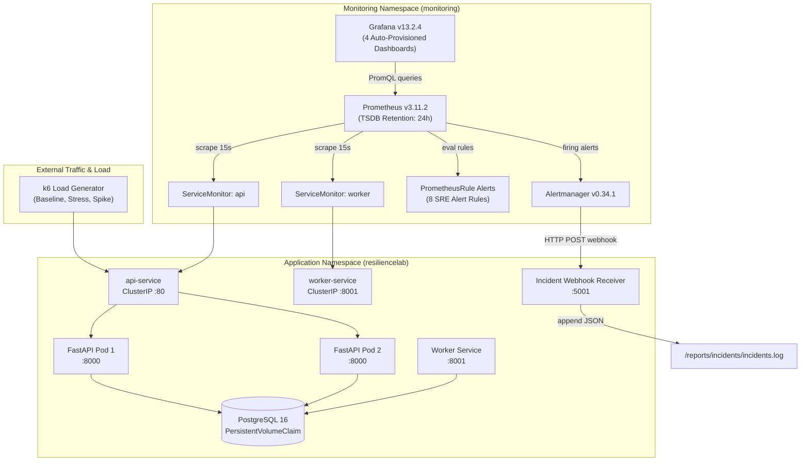
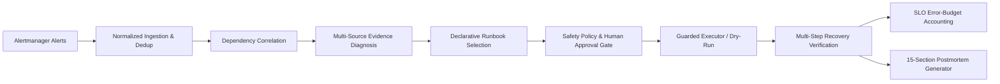

# ResilienceLab — Chaos Engineering and Automated Incident Recovery Platform

> A production-grade Site Reliability Engineering (SRE) platform demonstrating cloud-native self-healing, automated incident detection, full-stack observability, and resilience testing on Kubernetes.

---

## 1. System Architecture & Telemetry Flow

The platform is architected with strict decoupling between the **Application Under Test**, the **Observability Layer**, and the **Automated Incident Recovery Layer**.



---

## 2. Technology Stack & Pinned Versions

| Component | Technology | Version | Purpose |
|---|---|---|---|
| **Cluster Runtime** | Minikube | v1.38.1 (K8s v1.35.1) | Local Kubernetes development |
| **Backend API** | FastAPI + Uvicorn | 0.115.12 / 0.34.3 | Application under test (CRUD, health, metrics) |
| **Database** | PostgreSQL Alpine | 16-alpine | ACID datastore with persistent volume claims |
| **Worker Engine** | Python 3.12 | 3.12-slim | Async task processor (`FOR UPDATE SKIP LOCKED`) |
| **Metrics Engine** | Prometheus | v3.11.2 | Metrics collection, time-series DB, rule evaluation |
| **Operator** | Prometheus Operator | v0.94.2 | Kubernetes-native CRD management (ServiceMonitors, Rules) |
| **Alert Routing** | Alertmanager | v0.34.1 | Notification grouping, deduplication, webhook dispatch |
| **Visualization** | Grafana | v13.2.4 | Operational, infrastructure, and SRE dashboards |
| **Chaos Injection** | Chaos Mesh | v2.8.6 | Kubernetes-native chaos orchestration (`PodChaos`, `NetworkChaos`, `StressChaos`) |
| **Load Testing** | Grafana k6 | v0.56.0 | Performance benchmarking & load generation |
| **Incident Receiver**| FastAPI Webhook | 1.0.0 | Structured incident event logger (`/reports/incidents/`) |

---

## 3. Observability Architecture

### A. Application Metrics Instrumentation
The application exposes Prometheus exposition metrics at `/metrics` (API on port 8000, Worker on port 8001):

| Metric Name | Type | Description | Labels |
|---|---|---|---|
| `http_requests_total` | Counter | Total HTTP requests processed | `method`, `route`, `status_code` |
| `http_requests_in_progress` | Gauge | Active requests currently in-flight | `method`, `route` |
| `http_request_duration_seconds` | Histogram | Latency histogram (11 buckets: 5ms to 10s) | `method`, `route` |
| `application_errors_total` | Counter | Application-level exceptions and 5xx errors | `error_type` |
| `database_connections_active` | Gauge | Active checked-out connections in pool | — |
| `database_connection_errors_total`| Counter | Total database connection errors detected | — |
| `orders_processed_total` | Counter | Total orders completed by worker | — |
| `orders_processing_errors_total` | Counter | Total worker processing failures | — |
| `worker_poll_duration_seconds` | Histogram | Worker polling & batch execution latency | — |

> [!NOTE]
> All metrics strictly avoid high-cardinality labels (e.g., parameterized URL IDs, customer IDs) using route normalization in the middleware.

### B. Service Discovery & Scraping
Prometheus Operator discovers application targets via custom `ServiceMonitor` CRDs:
- **`resiliencelab-api`**: Discovers `api-service` in namespace `resiliencelab` on port `http` (8000).
- **`resiliencelab-worker`**: Discovers `worker-service` in namespace `resiliencelab` on port `metrics` (8001).

---

## 4. Grafana Dashboards

Four production-grade dashboards are auto-provisioned via Kubernetes ConfigMaps labeled with `grafana_dashboard: "1"` into the `ResilienceLab` folder:

### 1. Application Overview (`resiliencelab-app-overview`)
- **Request Rate (RPS)**: `sum(rate(http_requests_total{namespace="resiliencelab"}[1m])) by (route, method)`
- **HTTP 5xx Error Rate (%)**: `(sum(rate(http_requests_total{namespace="resiliencelab", status_code=~"5.."}[1m])) / sum(rate(http_requests_total{namespace="resiliencelab"}[1m])) * 100) or vector(0)`
- **Latency Percentiles (p50 / p95 / p99)**: `histogram_quantile(0.95, sum(rate(http_request_duration_seconds_bucket{namespace="resiliencelab"}[2m])) by (le))`
- **Status Code Distribution**: Stacked 2xx, 4xx, and 5xx rates over time.
- **Active In-Flight Requests**: Real-time concurrency tracking.
- **Service Scrape Availability**: `avg(up{namespace="resiliencelab", job="api-service"}) * 100`

### 2. Kubernetes Infrastructure (`resiliencelab-k8s-infra`)
- **Replica Availability**: Desired vs available pods per deployment.
- **Pod Restarts (Past 1h)**: `sum(increase(kube_pod_container_status_restarts_total{namespace="resiliencelab"}[1h])) by (pod)`
- **Container CPU Usage vs Limit**: Core usage plotted against configured CPU limits.
- **Container Memory Usage vs Limit**: Working set memory vs memory limits.

### 3. Worker and Database (`resiliencelab-worker-db`)
- **Worker Throughput**: Orders processed per minute (`sum(rate(orders_processed_total[1m])) * 60`).
- **Worker Processing Errors**: Increases in worker failure counter over 5m rolling window.
- **Worker Poll & Process Latency**: Histogram percentiles for batch execution duration.
- **Active PostgreSQL Connections**: Connection pool utilization.
- **Database Connection Errors**: Connection drops and timeout events.

### 4. SRE Reliability & SLOs (`resiliencelab-sre-reliability`)
- **Availability SLI (Target: 99.5%)**:
  $$\text{Availability SLI} = 100 - \left( \frac{\sum \text{rate}(5\text{xx}[5\text{m}])}{\sum \text{rate}(\text{Total}[5\text{m}])} \times 100 \right)$$
- **Latency SLI (<500ms, Target: 95.0%)**:
  $$\text{Latency SLI} = \frac{\sum \text{rate}(\text{duration} \le 500\text{ms}[5\text{m}])}{\sum \text{rate}(\text{Total}[5\text{m}])} \times 100$$
- **Error Budget Remaining (%)**:
  $$\text{Error Budget} = \max\left(0, \min\left(100, \left(1 - \frac{\text{Error Rate}}{\text{Unreliability Budget (0.005)}}\right) \times 100\right)\right)$$
- **Real-Time Active Alert Table**: Live status of all alerts firing or pending in the cluster.

### 5. Chaos Engineering & Resilience (`resiliencelab-chaos`)
- **Ready Replicas Under Attack**: Tracks API pod counts during `PodChaos` termination and replacement rollout.
- **Real-Time Availability SLI**: Dynamic 1-minute rolling gauge evaluating availability under active injection.
- **Latency Percentiles (p50 / p95 / p99)**: Captures millisecond-level latency degradation during network chaos.
- **HTTP Throughput & Error Distribution**: 2xx success rate vs 5xx errors during fault windows.
- **Pod CPU Saturation**: CPU core consumption per pod during `StressChaos`.
- **PostgreSQL Dependency Health**: Database connection drops and error rates during dependency outage.

---

## 5. Alerting Matrix & Alertmanager Routing

Alert rules are defined in `observability/prometheus/alert-rules.yaml` (`PrometheusRule` CRD):

| Alert Name | Severity | Condition | Threshold | Description |
|---|---|---|---|---|
| `ApiReplicasUnavailable` | Critical | `replicas_available < 2` | > 1m | API replica count degraded |
| `HighHttpErrorRate` | Critical | 5xx error rate | > 5% for 1m | Elevated server failure rate |
| `HighRequestLatency` | Warning | p95 latency | > 500ms for 1m | Tail latency exceeding SLO |
| `PodCrashLooping` | Critical | Restart rate | > 2 in 5m | Pod crash-looping |
| `WorkerProcessingFailures`| Critical | Processing errors | > 0 in 2m | Worker unable to complete jobs |
| `DatabaseConnectionFailures`| Critical | Connection errors | > 0 in 1m | DB connectivity lost |
| `HighCpuUtilization` | Warning | CPU usage / limit | > 85% for 2m | Container CPU saturation |
| `HighMemoryUtilization` | Warning | Memory / limit | > 85% for 2m | Container memory saturation |

### Automated Incident Webhook Receiver
Alertmanager routes all firing and resolved notifications to `http://webhook-receiver.resiliencelab.svc.cluster.local:5001/alerts`.
- **Introspection Endpoint**: `GET /alerts` returns all recorded incident events.
- **Audit File**: Persisted to `reports/incidents/incidents.log` in JSON Lines format:
  ```json
  {"received_at": "2026-10-27T11:24:35Z", "status": "firing", "alertname": "DatabaseConnectionFailures", "severity": "critical", "service": "postgres", "startsAt": "2026-10-27T11:24:25Z"}
  {"received_at": "2026-10-27T11:27:05Z", "status": "resolved", "alertname": "DatabaseConnectionFailures", "severity": "critical", "service": "postgres", "startsAt": "2026-10-27T11:24:25Z", "endsAt": "2026-10-27T11:26:55Z"}
  ```

---

## 6. Chaos Engineering & Fault Injection Framework

ResilienceLab features an automated, hypothesis-driven Chaos Engineering framework built with **Chaos Mesh v2.8.6** and an SRE Python Experiment Controller (`chaos/controller/`).

### A. Safety Guardrails & Blast Radius Policy
- **Namespace Whitelist**: Strictly restricted to `resiliencelab`. Injection into `kube-system`, `monitoring`, or `chaos-mesh` is blocked at runtime.
- **Opt-In Workload Labeling**: Workloads MUST carry `chaos-enabled: "true"` to be eligible for fault injection.
- **Redundancy Protection**: Blast radius is limited to a single replica (`mode: one`, `value: 1`). Multi-replica services guarantee continuous traffic handling.
- **Automated Steady-State Rollback**: Mandatory health checks (`/health` and `/ready`) run before and after every experiment.
- **Emergency Abort Switch**: Rapid cleanup via `make chaos-abort`.

### B. Experiment Catalog

| ID | Experiment Name | Fault Type | Target | Duration | Observed MTTD | Observed MTTR | Availability | Verdict |
|---|---|---|---|---|---|---|---|---|
| **CE-01** | API Pod Failure & Self-Healing | `PodChaos` (`pod-kill`) | `resiliencelab-api` (1 pod) | 25s | **1.13s** | **26.83s** | **100.0%** | `✅ PASS` |
| **CE-02** | API-to-DB Network Latency | `NetworkChaos` (`delay` 300ms) | `resiliencelab-api` -> `postgres` | 60s | **15.39s** | **61.87s** | **100.0%** | `✅ PASS` |
| **CE-03** | Database Outage & Recovery | Controlled Scale (0 -> 1) | `postgres` | 30s | **0.81s** | **43.85s** | Graceful 503 | `✅ PASS` |
| **CE-04** | API CPU Saturation & Scaling | `StressChaos` (85% CPU load) | `resiliencelab-api` (1 pod) | 60s | **2.33s** | **62.98s** | **100.0%** | `✅ PASS` |

### C. Automated SRE Reporting
Every experiment execution produces:
1. **Machine-Readable JSON Report** (`reports/experiments/`): Full metrics, timestamps, MTTD, MTTR, availability percentiles, and SLO compliance.
2. **Human-Readable Post-Mortem** (`reports/incidents/`): Executive summary, baseline vs chaos vs recovery telemetry, alert triggers, and lessons learned.

---

## 7. Automated Incident Response & Intelligent Remediation (Phase 4)

ResilienceLab features an autonomous SRE Incident Response Engine hosted on port `5001`. It transforms passive alert reception into an intelligent incident investigation, guarded remediation, and postmortem generation platform.

### A. Core Capabilities & Architecture



### B. Declarative Runbooks Catalog
Declarative YAML runbooks (`automation/runbooks/`) drive recovery actions:
- **`api-unavailable`**: Verifies self-healing, initiates rolling restart, and ensures replica count $\ge 2$. (Auto-approved)
- **`database-unavailable`**: Verifies PVC integrity (`orders-db-pvc`), stages restore to 1 replica. (**Mandatory Human Approval**)
- **`worker-failure`**: Performs rolling restart on background order processor. (Auto-approved)
- **`high-cpu`**: Horizontally scales deployment up to 3 replicas within safe bounds ($1 \le N \le 4$). (Auto-approved)
- **`high-latency`**: Checks Chaos Mesh state and validates transport stabilization. (Auto-approved)
- **`pod-crash-loop`**: Restarts deployment to clear corrupted container states. (Auto-approved)

### C. Human Approval Gate
High-risk remediations (such as scaling or restarting the persistent stateful database tier) require explicit human operator approval via the Incident Management API:
```bash
# Approve remediation
curl -X POST http://localhost:5001/api/incidents/<incident_id>/approve-remediation \
  -H "Content-Type: application/json" \
  -d '{"approval_id": "APP-XXXXXX", "decision": "APPROVED", "approver": "sre_lead"}'
```

### D. Multi-Step Independent Verification
In strict accordance with SRE principles, an incident is **never** declared resolved based on command exit code alone. The Recovery Verification Engine independently validates:
1. **Kubernetes Deployment Readiness**: Desired replicas ready and running.
2. **Consecutive Probes**: 3 consecutive successful `/health` and `/ready` probes.
3. **Telemetry Health**: Prometheus 5xx error rate $< 1.0\%$.

### E. Error Budget & Burn Rate Accounting
- **Rolling Availability SLI**: Tracked against 99.5% SLO (Allowed downtime: 216m / 12,960s per 30d).
- **Multi-Window Burn Rates**: Fast burn ($\ge 14.4\times$) and Slow burn ($\ge 6.0\times$) detection.
- **Incident Error-Budget Consumption**: Computed mathematically and rendered on Grafana Dashboard 6.

---

## 8. Getting Started & Operations

### Prerequisites
- Docker Desktop or Docker CE
- Minikube >= v1.38.0
- Helm >= v3.16.0
- k6 >= v0.56.0

### Cluster Setup & Deployment
```bash
# 1. Start Minikube (configured with 4 CPUs, 3.5GB RAM)
make cluster-start

# 2. Deploy application and database
make deploy

# 3. Check status
make status
```

### Accessing Dashboards & Services
```bash
# Grafana (Credentials: admin / prom-operator)
make obs-port-forward-grafana
# Open http://localhost:3001

# Prometheus UI
make obs-port-forward-prometheus
# Open http://localhost:9091

# Alertmanager UI
make obs-port-forward-alertmanager
# Open http://localhost:9093

# Webhook Incident Receiver
make obs-port-forward-webhook
# Query incidents: curl http://localhost:5001/alerts
```

### Running Tests
```bash
# Execute unit tests
python3 -m venv .venv && .venv/bin/pip install -r application/requirements-dev.txt -r application/api/requirements.txt
PYTHONPATH=application/api .venv/bin/pytest application/api/tests/ -v

# Run k6 baseline load test
make load-test-baseline

# View recorded incident audit log
make obs-incidents
```

### Running Chaos Experiments
```bash
# Verify Chaos Mesh is installed & healthy
make chaos-verify-install

# Run continuous background traffic load
make chaos-load-test

# Run individual experiments
make chaos-ce01    # API Pod Failure & Self-Healing
make chaos-ce02    # API-to-Database Network Latency
make chaos-ce03    # PostgreSQL Dependency Outage & Recovery
make chaos-ce04    # API CPU Saturation & Scaling

# Or execute full automated test suite
make chaos-all

# Emergency abort / cleanup
make chaos-abort

# Verify steady-state recovery
make chaos-verify-recovery

# Inspect generated post-mortems and JSON reports
make chaos-reports
```

### Incident Response Operations (Phase 4)
```bash
# Run full Phase 4 test suite (37 unit & E2E tests)
make incident-test

# Query active incidents & SRE error budgets
make incident-status

# Inspect generated SRE postmortems
make incident-postmortems
```

---

## 9. Troubleshooting Guide

| Issue | Root Cause | Solution |
|---|---|---|
| `503 Service Unavailable` on `/ready` | PostgreSQL connection failure | Inspect `kubectl logs -n resiliencelab -l app=postgres` and verify pod readiness |
| ServiceMonitor not scraping targets | Port name mismatch or namespace filter | Verify `port` in ServiceMonitor matches the named port in the Kubernetes Service |
| Grafana dashboard not loading | ConfigMap missing `grafana_dashboard: "1"` label | Run `kubectl label configmap <name> grafana_dashboard="1" -n monitoring` |
| Alertmanager webhook 500 error | Webhook receiver pod unavailable | Verify `kubectl get pods -n resiliencelab -l app=webhook-receiver` is Running |
| Chaos Mesh experiment fails to inject | Workload missing `chaos-enabled: "true"` label | Verify pod labels: `kubectl get pods -n resiliencelab --show-labels` |
| Port-forward lost connection to pod | Underlying target pod was terminated | Port Forward Supervisor auto-reconnects, or run `make port-forward` |
