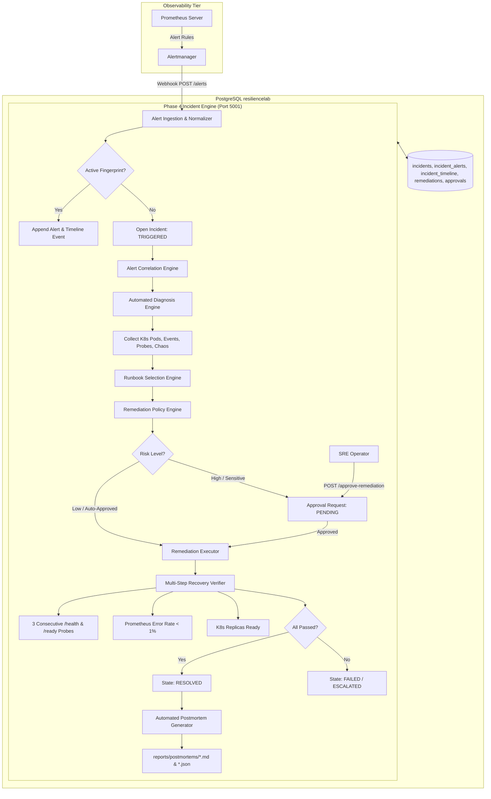

# ResilienceLab — Autonomous Incident Response & Intelligent Remediation Architecture

## 1. Executive Summary

Phase 4 transforms **ResilienceLab** from a passive detection platform into an **Autonomous SRE Incident Response Engine**. The platform ingests real-time alert notifications from Prometheus Alertmanager, normalizes and deduplicates alert streams, correlates multi-service cascading failures using a directed dependency graph, performs multi-source evidence-based diagnosis, executes policy-guarded remediation runbooks with human approval gates, verifies recovery through independent multi-step probing, tracks rolling SLO error budgets, and automatically compiles 15-section Google SRE postmortems.

---

## 2. Platform Architecture & Data Flow



---

## 3. Incident Lifecycle State Machine

The incident lifecycle enforces deterministic, audited state progression:

```
[TRIGGERED]
    │
    ▼
[ACKNOWLEDGED]
    │
    ▼
[INVESTIGATING] ◄───────────────────┐
    │                               │
    ▼                               │
[REMEDIATING]                       │
    │ (Requires Human Approval for High-Risk)
    ▼                               │
[VERIFYING]                         │
    ├──► [RESOLVED] (All Probes & Telemetry Verified)
    │
    └──► [FAILED] ──► [ESCALATED] ──┘
```

### Transition Guardrails:
1. **No False Recovery**: An incident cannot transition from `REMEDIATING` directly to `RESOLVED`. It MUST enter `VERIFYING` and satisfy independent multi-step verification.
2. **Audit Logging**: Every single state change writes an immutable audit record to `incident_timeline` with timestamp, actor, previous state, new state, and reason.

---

## 4. SRE Key Metrics & Durations

All durations follow standard Site Reliability Engineering definitions:

| Metric | Formula | Description |
| :--- | :--- | :--- |
| **TTD** (Time to Detect) | $T_{\text{detected}} - T_{\text{incident\_start}}$ | Latency from failure injection to Alertmanager alert firing |
| **TTA** (Time to Alert) | $T_{\text{webhook\_received}} - T_{\text{incident\_start}}$ | Latency from start until webhook ingestion |
| **TTAck** (Time to Acknowledge) | $T_{\text{acknowledged}} - T_{\text{webhook\_received}}$ | Time before operator or engine acknowledges incident |
| **TTDiag** (Time to Diagnose) | $T_{\text{diagnosis\_complete}} - T_{\text{acknowledged}}$ | Evidence collection and root-cause analysis duration |
| **TTM** (Time to Mitigate) | $T_{\text{remediation\_executed}} - T_{\text{diagnosis\_complete}}$ | Time to select, approve, and execute remediation action |
| **TTR** (Time to Recover) | $T_{\text{verified\_healthy}} - T_{\text{remediation\_executed}}$ | Verification window until steady-state is confirmed |
| **Total Outage Duration** | $T_{\text{verified\_healthy}} - T_{\text{incident\_start}}$ | Total downtime experienced by users |

---

## 5. Service Level Objectives (SLOs) & Error Budget Mathematics

- **Availability SLO**: 99.5% availability over a 30-day rolling window ($2,592,000\text{ seconds}$).
- **Allowed Downtime**: $(100\% - 99.5\%) \times 30\text{ days} = 12,960\text{ seconds} = 216\text{ minutes}$.
- **Latency SLO**: 95% of HTTP requests served in $< 200\text{ms}$.
- **Burn Rate Multiple**:
  $$\text{Burn Rate} = \frac{\text{Actual Error Rate}}{\text{Allowed Error Rate}} = \frac{\text{Actual Error Rate}}{0.005}$$
  - **Fast Burn Rate ($\ge 14.4\times$)**: Consumes 2% of monthly budget in 1 hour (Critical alert).
  - **Slow Burn Rate ($\ge 6.0\times$)**: Consumes 5% of monthly budget in 6 hours (Warning alert).
- **Incident Error-Budget Consumption**:
  $$\text{Budget Consumed (\%)} = \frac{\text{Outage Duration (s)} \times \text{Degradation Factor}}{12,960\text{s}} \times 100\%$$

---

## 6. Safety Policies & Blast Radius Controls

1. **Namespace Whitelist**: Executions strictly restricted to `resiliencelab`. Forbidden: `kube-system`, `monitoring`, `chaos-mesh`, `default`.
2. **Data Safety Guarantee**: Absolute prohibition against PVC deletion (`orders-db-pvc`) or destructive database queries.
3. **Replica Limits**: Scaling bounded strictly between 1 and 4 replicas ($1 \le N \le 4$).
4. **Approval Gate**: Any action modifying stateful tiers (e.g. `scale_deployment` on `deploy/postgres`) requires explicit human approval via API.
5. **Dry-Run by Default**: Safe simulation mode previews commands without altering cluster state until explicitly authorized.
