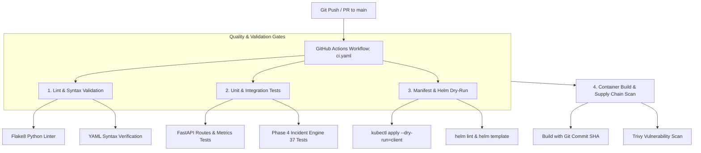

# Continuous Integration Pipeline (GitHub Actions)

**Author**: Senior Site Reliability Engineer, DevOps & Cloud-Native Architect  
**Phase**: Phase 5 — Stage B  
**Status**: IMPLEMENTED & VALIDATED  

---

## 1. Overview & Objectives

In ResilienceLab, the **Continuous Integration (CI)** pipeline serves as the primary automated gatekeeper of system reliability. No code reaches container packaging, Helm chart templating, or GitOps reconciliation without satisfying strict automated quality gates.

The CI workflow is defined declaratively in [`.github/workflows/ci.yaml`](file:///.github/workflows/ci.yaml) and mirrors local operational targets available in the [`Makefile`](file:///Makefile).

---

## 2. Pipeline Architecture & Workflow Flow



---

## 3. Job Specifications & Gates

### Job 1: `lint-and-syntax`
- **Flake8 Linter**: Scans `application/` and `automation/` against PEP 8 standards with a maximum line length of 120 characters (`.flake8`).
- **YAML Manifest Validation**: Traverses all YAML files across the repository (`kubernetes/`, `observability/`, `automation/runbooks/`) and validates YAML parsing using `yaml.safe_load_all`.

### Job 2: `test-unit-and-integration`
- **Application API Suite**: Validates health check endpoints (`/health`, `/ready`), Prometheus metrics exposition (`/metrics`), and database disconnection behavior.
- **Incident Engine Suite**: Executes all 37 automated tests across alert ingestion, topological correlation, multi-source diagnosis, runbook execution, human approval gates, recovery verification, and SLO error budget accounting.

### Job 3: `manifest-and-helm-validation`
- **Kubernetes Client Dry-Run**: Evaluates raw manifests in `kubernetes/` against the Kubernetes API schema using `kubectl apply --dry-run=client`.
- **Helm Linter & Templating**: Runs `helm lint` and `helm template` against `deployments/helm/resiliencelab/` to detect chart syntax or template interpolation errors.

### Job 4: `container-build-and-scan`
- **Multi-Stage Docker Builds**: Builds `resiliencelab-api` and `resiliencelab-worker` tagged with the immutable Git commit SHA (`${{ github.sha }}`).
- **Trivy Image Scan**: Scans container filesystems for known CVEs across Alpine/Debian base layers and Python dependencies.

---

## 4. Local Execution Equivalents

Developers can execute identical validation steps locally prior to pushing:

```bash
# Linting & YAML verification
make ci-lint

# Full automated test suite
make ci-test

# Kubernetes manifest dry-run
make ci-validate-manifests
```

---

## 5. Security Model & Least Privilege
- **Permissions**: Workflow defines top-level `permissions: contents: read` and `security-events: write` (for Trivy SARIF uploads).
- **Concurrency Guard**: `concurrency.cancel-in-progress: true` prevents redundant runner consumption on rapid commits to the same branch.
- **Secret Isolation**: Pull requests do not have access to deployment secrets or write tokens.
