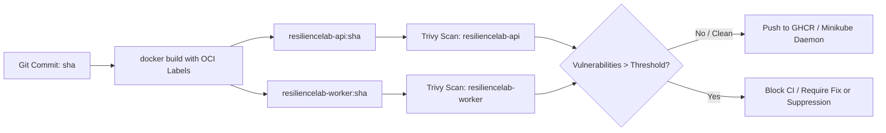

# Container Build & Supply Chain Security (GHCR & Trivy)

**Author**: Senior Site Reliability Engineer, DevOps & Cloud-Native Architect  
**Phase**: Phase 5 — Stage C  
**Status**: IMPLEMENTED & VALIDATED  

---

## 1. Principles & Objectives

In modern cloud-native reliability engineering, container supply chain security ensures that only verified, signed, and vulnerability-free artifacts are promoted to running Kubernetes environments.

Key architectural requirements:
1. **Immutability**: Every container image is built and tagged with the exact 7-character Git commit SHA (`git rev-parse --short HEAD`). The mutable `:latest` tag is prohibited for deployment manifests.
2. **Provenance & OCI Labels**: Images embed standard Open Container Initiative (OCI) annotations linking each artifact back to its source repository commit and build timestamp.
3. **Automated Vulnerability Scanning**: **Trivy** inspects container filesystems and application dependency locks before image publishing.
4. **Registry Storage**: Images are structured for publication to **GitHub Container Registry (GHCR)** under `ghcr.io/dineth2003-dev/resiliencelab-<service>:<git-sha>`.

---

## 2. Container Build & Packaging Architecture



---

## 3. Vulnerability Severity & Remediation Policy

### 3.1 Gating Rules
- **CRITICAL Vulnerabilities**: Any unpatched CRITICAL vulnerability with an upstream vendor fix immediately fails the CI pipeline (`--exit-code 1`).
- **HIGH Vulnerabilities**: HIGH vulnerabilities are reported in the CI build summary table. Teams must schedule dependency upgrades if fixes exist.
- **Unfixed Upstream Vulnerabilities**: In cases where Debian or Alpine has not yet released an upstream patch for an OS CVE, `--ignore-unfixed` is applied, or the vulnerability is documented in [`.trivyignore`](file:///.trivyignore) with a justification and review date.

### 3.2 OCI Labels & Metadata
Both API and Worker Dockerfiles receive runtime metadata:
- `org.opencontainers.image.revision`: Git commit SHA.
- `org.opencontainers.image.created`: UTC timestamp.
- `org.opencontainers.image.source`: GitHub repository URL.

---

## 4. Local Operations

Developers can build and scan locally using the automated automation script and Makefile:

```bash
# Build images and scan with Trivy
make ci-build

# Or run standalone Trivy scan against currently built SHA
make ci-scan

# Or run automated script directly with strict enforcement
./scripts/ci/build-and-scan.sh --strict
```
