# GitOps Architecture & Reconciliation Flow

**Author**: Senior Site Reliability Engineer, DevOps & Cloud-Native Architect  
**Phase**: Phase 5 — Stage E  
**Status**: IMPLEMENTED & VALIDATED  

---

## 1. Executive Summary & Principles

Phase 5 establishes **GitOps** as the single source of truth and continuous delivery mechanism for ResilienceLab on Kubernetes. 

Core principles:
1. **Git as the Single Source of Truth**: The entire desired state of the system—Helm chart, environment overlays, and cluster synchronization definitions—is version-controlled in Git.
2. **Pull-Based Continuous Reconciliation**: Rather than external CI push pipelines running direct `kubectl apply` with elevated cluster credentials, in-cluster **Flux CD** controllers pull the desired state from Git and reconcile differences.
3. **Automated Drift Detection & Healing**: If an operator or rogue script introduces an out-of-band change into the cluster (e.g. scaling a deployment directly via `kubectl scale`), Flux detects the configuration drift and automatically heals the cluster back to the Git desired state.
4. **Least-Privilege Cluster Boundary**: Minikube remains unexposed to public GitHub runner networks; communication is strictly outbound from Flux to Git.

---

## 2. Architecture & Component Interaction

```mermaid
flowchart TD
    GitRepo[Git Repository on GitHub<br/>dineTH2003-dev/Chaos-Engineering...] -->|1m Fetch Interval| FluxSource[Flux source-controller]
    
    subgraph FluxNamespace ["flux-system Namespace"]
        FluxSource -->|Artifact Storage| LocalArtifact[In-Memory Chart Artifact]
        LocalArtifact --> FluxHelm[Flux helm-controller]
        FluxHelm --> HelmRel[HelmRelease CRD: resiliencelab]
    end

    subgraph AppNamespace ["resiliencelab Namespace"]
        HelmRel -->|Declarative Reconcile| K8sWorkloads[Deployments, Services, ConfigMaps]
        K8sWorkloads --> API[resiliencelab-api]
        K8sWorkloads --> WRK[resiliencelab-worker]
        K8sWorkloads --> PG[PostgreSQL & postgres-pvc]
    end

    OutBand[Manual kubectl Drift] -.->|Overwritten by Flux| K8sWorkloads
```

---

## 3. Custom Resource Definitions (CRDs)

### A. `GitRepository` (`deployments/gitops/apps/resiliencelab/gitrepository.yaml`)
- **API**: `source.toolkit.fluxcd.io/v1`
- **Interval**: `1m`
- **URL**: `https://github.com/dineTH2003-dev/Chaos-Engineering-Automated-Incident-Recovery-Platform.git`
- **Branch**: `main`
- **Filter**: Ignores `/docs/`, `/reports/`, and markdown documentation to avoid unnecessary reconciliation triggers.

### B. `HelmRelease` (`deployments/gitops/apps/resiliencelab/helmrelease.yaml`)
- **API**: `helm.toolkit.fluxcd.io/v2`
- **Chart Path**: `./deployments/helm/resiliencelab`
- **Values Override**: `./deployments/helm/environments/development/values.yaml`
- **Remediation Policy**: Retries failed upgrades up to 3 times before entering a terminal failed state.
