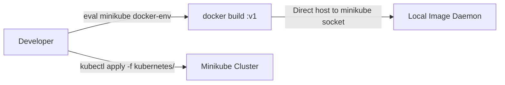

# ResilienceLab — Phase 5 Readiness Audit & Architecture Assessment

**Author**: Senior Site Reliability Engineer, DevOps & Cloud-Native Architect  
**Project**: ResilienceLab — Chaos Engineering and Automated Incident Recovery Platform  
**Target Phase**: Phase 5 — GitOps-Driven CI/CD & SRE-Aware Progressive Delivery  
**Baseline Git Commit**: `c49d3e3` (feat: Phase 4 completed)  
**Date**: October 2026  
**Status**: APPROVED BASELINE / STAGE A AUDIT COMPLETE  

---

## 1. Executive Summary

This readiness audit conducts a comprehensive architectural, operational, and resource capacity assessment of **ResilienceLab** prior to initiating **Phase 5: GitOps-Driven CI/CD & SRE-Aware Progressive Delivery**. 

The goal of Phase 5 is to elevate ResilienceLab from an incident response and fault injection platform into a **reliability-aware software delivery ecosystem**. In this target architecture:
1. Every code change is verified through automated continuous integration (linting, testing, security scanning).
2. Application containers are packaged into immutable, signed, and scanned artifacts stored in GitHub Container Registry (GHCR).
3. Kubernetes resources are packaged into production-grade Helm charts with strict environment separation.
4. Cluster state is continuously synchronized and reconciled with Git using **Flux CD**, eliminating manual `kubectl` state mutations.
5. Post-deployment rollouts are guarded by an **Independent Deployment Health Verification Engine** and **SRE SLO Release Gates** (HTTP error rates, p95 latency, availability, worker throughput).
6. Faulty releases trigger automated GitOps-compatible rollbacks with automatic correlation and incident creation in the existing Phase 4 Incident Management Engine.
7. Deployment velocity and reliability telemetry (DORA metrics: deployment frequency, lead time, change failure rate, MTTR) are visualized in Grafana.

---

## 2. Phase 1–4 Verification & Operational Health

A non-destructive inspection of the running environment was executed. All components across previous phases remain fully operational and healthy.

### 2.1 Component Health Matrix

| Phase | Component | Technology | Target State | Live Cluster Observation | Health Status |
| :--- | :--- | :--- | :--- | :--- | :--- |
| **Phase 1** | Backend API | FastAPI (Python 3.12) | 2 replicas, port 8000 | 2/2 Pods Running, 0 Restarts, Ready | `✅ HEALTHY` |
| **Phase 1** | Background Worker | Python 3.12 | 1 replica, port 8001 | 1/1 Pod Running, 0 Restarts, Ready | `✅ HEALTHY` |
| **Phase 1** | Database | PostgreSQL 16 Alpine | 1 replica, port 5432 | 1/1 Pod Running, 0 Restarts, Ready | `✅ HEALTHY` |
| **Phase 1** | Persistent Storage | PVC `postgres-pvc` | 1Gi, Bound | Bound (`standard` storageclass) | `✅ HEALTHY` |
| **Phase 2** | Metrics Collection | Prometheus v3.11.2 | Scrape 15s | Running (2/2 containers), scraping targets | `✅ HEALTHY` |
| **Phase 2** | Alert Routing | Alertmanager v0.34.1 | Route to webhook | Running (2/2 containers), active routing | `✅ HEALTHY` |
| **Phase 2** | Visualization | Grafana v13.2.4 | 6 Dashboards active | Running (3/3 containers), port 3001 active | `✅ HEALTHY` |
| **Phase 3** | Chaos Orchestration | Chaos Mesh v2.8.6 | Controller & Daemon | 2/2 Pods Running, 4 CRDs registered | `✅ HEALTHY` |
| **Phase 4** | Incident Platform | Webhook / Engine | Port 5001 | 1/1 Pod Running, DB tables populated | `✅ HEALTHY` |

### 2.2 Data Integrity & Persistence Verification
- **Persistent Volume Claim**: `postgres-pvc` (1Gi) is bound and undamaged.
- **Order Data Preservation**: PostgreSQL database `resiliencelab` was inspected directly via `psql`. **1,468 completed customer orders** from Phases 1–4 are completely intact.
- **Incident Storage**: Phase 4 PostgreSQL tables (`incidents`, `incident_alerts`, `incident_timeline`, `remediations`, `approvals`) are present with active constraints and foreign keys.

### 2.3 Automated Test Suite Breakdown
The complete test suite was executed in the project virtual environment (`.venv`):
- **Phase 4 Incident Engine**: `pytest automation/incident/tests/ -v` $\rightarrow$ **37 passed** (30.26s).
- **Phase 1 Application API**: `pytest application/api/tests/ -v` $\rightarrow$ **5 passed, 2 skipped (live DB)** (2.88s).

#### Test Classification Analysis:
1. **Unit Tests (15 tests)**:
   - `test_stage_b_models_and_repos.py`: Entity definitions, state transitions, validation logic.
   - `test_stage_e_runbooks.py`: Declarative YAML runbook schema validation and variable resolution.
   - `test_stage_i_slo.py`: Mathematical burn rate calculations, error budget consumption formulas.
   - `test_stage_j_postmortem.py`: 15-section postmortem markdown and JSON rendering.
   - `application/api/tests/test_health.py`: Route structure, health response codes, metrics exposition format.
2. **Mocked Integration Tests (18 tests)**:
   - `test_stage_c_alert_ingestion.py`: Alertmanager webhook parsing, fingerprint deduplication, and lifecycle transitions using in-memory SQLite and FastAPI `TestClient`.
   - `test_stage_d_correlation_and_diagnosis.py`: Topological dependency graph traversing `postgres -> api -> worker` with mocked Kubernetes events and Chaos Mesh state.
   - `test_stage_f_g_remediation.py`: Policy engine allowlist enforcement, blast radius constraints, dry-run mode, and human approval gates.
   - `test_stage_h_verification.py`: Multi-step verification mocking consecutive probe responses and Prometheus error rate thresholds.
3. **Mocked End-to-End Scenarios (4 tests)**:
   - `test_stage_k_e2e_scenarios.py`: Full end-to-end incident lifecycles (`TRIGGERED -> INVESTIGATING -> REMEDIATING -> VERIFYING -> RESOLVED`) across 4 incident types (API outage, DB outage with human approval gate, CPU saturation, latency correlation).
4. **Live Cluster Tests (Real Execution)**:
   - `make test-health`: Live HTTP curl probes against port-forwarded Kubernetes API service (`/health`, `/ready`, `/metrics`).
   - `make chaos-all`: Real-time fault injection using Chaos Mesh CRDs against live Minikube containers with k6 synthetic load.
   - Direct Prometheus/Grafana PromQL queries evaluating live cluster telemetry.

---

## 3. Current CI/CD Status & Identified Gaps

### 3.1 Existing Deployment Workflow
Currently, deployment is entirely manual, imperative, and coupled to the local developer machine:


### 3.2 Detailed Gap Analysis

| Dimension | Current State (Phase 4) | Required State (Phase 5) | Severity / Risk |
| :--- | :--- | :--- | :--- |
| **CI Automation** | `.github/workflows/` directory is empty. No CI runs on push or PR. | GitHub Actions CI workflow running linting, formatting, unit tests, Helm lint, and manifest validation on every PR/push. | **CRITICAL**: Regression risks undetected before merging. |
| **Container Supply Chain** | Local `docker build` with mutable `:v1` tag. No registry push. | Multi-stage Docker builds tagged with immutable Git commit SHAs, pushed to GitHub Container Registry (GHCR). | **HIGH**: Lack of traceability, repeatability, and immutable artifacts. |
| **Vulnerability Scanning** | None. Images deployed without security analysis. | Automated **Trivy** scanning in CI for OS and Python dependencies with clear severity gating policy. | **HIGH**: Vulnerable packages deployed unknowingly. |
| **Packaging & Templating** | Raw, hardcoded YAML manifests in `kubernetes/`. | Modular **Helm charts** in `deployments/helm/` with environment values (`development`, `staging`). | **MEDIUM**: Inflexible configuration and environment duplication. |
| **GitOps Reconciliation** | Imperative `kubectl apply`. No desired state reconciliation. | **Flux CD** GitOps controllers continuously reconciling cluster state against Git. Drift detection and automated self-correction. | **HIGH**: Cluster state drifts from Git; manual mutations untracked. |
| **Deployment Health Verification**| Success is declared as soon as `kubectl rollout status` exits. | **Independent Deployment Verification Engine** checking pod readiness, restart count, 3 consecutive `/health` & `/ready` probes, and Prometheus error rate. | **CRITICAL**: SRE anti-pattern (traffic routed to subtly broken release). |
| **Release Gating** | No release gates. Any committed change rolls out blindly. | **SRE-Aware SLO Release Gates** checking 5xx error rate, p95 latency, and burn rate against 99.5% SLO before promotion. | **HIGH**: Faulty code depletes error budget silently. |
| **Rollback Strategy** | Manual rollback via kubectl or manual manifest edit. | **Automated GitOps-Compatible Rollback** triggering Git reversion, Flux reconciliation, and Phase 4 Incident Engine escalation. | **HIGH**: Manual rollbacks cause GitOps drift fighting. |
| **Deployment Observability** | No metrics on release frequency, change failure rate, or MTTR. | **Deployment Reliability Grafana Dashboard (Dashboard 7)** tracking DORA metrics and release-correlated anomalies. | **MEDIUM**: Blindness to software delivery performance. |

---

## 4. Kubernetes Cluster Resource Capacity & Budgeting

### 4.1 Live Cluster Resource Analysis
Resource allocations and live utilization were measured on the Minikube node:

```
Node Capacity:    12 CPUs | 3,827,516 Ki Memory (~3,737 MiB / 3.65 GiB)
Node Allocatable: 12 CPUs | 3,827,516 Ki Memory (~3,737 MiB)

Total Pod Requests: CPU = 1,570m (~1.57 cores) | Memory = 1,716 MiB (45.9% of allocatable)
Total Pod Limits:   CPU = 3,400m (~3.40 cores) | Memory = 3,992 MiB

Live Consumption (kubectl top nodes):
- CPU Usage:    1,420m (11% of capacity)
- Memory Usage: 2,600 MiB (69% of capacity)
- Memory Headroom: ~1,137 MiB remaining before VM memory pressure
```

### 4.2 Pod Resource Footprint Breakdown

| Namespace | Workload | Replicas | CPU Request / Limit | Memory Request / Limit | Live Memory Usage |
| :--- | :--- | :--- | :--- | :--- | :--- |
| `resiliencelab` | `api` | 2 | 200m / 1000m | 256Mi / 1024Mi | ~130 MiB |
| `resiliencelab` | `worker` | 1 | 50m / 250m | 64Mi / 256Mi | ~46 MiB |
| `resiliencelab` | `postgres` | 1 | 100m / 500m | 256Mi / 512Mi | ~38 MiB |
| `resiliencelab` | `webhook-receiver` | 1 | 25m / 100m | 48Mi / 128Mi | ~35 MiB |
| `monitoring` | `prometheus` | 1 | 200m / 500m | 400Mi / 800Mi | ~374 MiB |
| `monitoring` | `grafana` | 1 | 100m / 200m | 150Mi / 300Mi | ~453 MiB |
| `monitoring` | `alertmanager` | 1 | 50m / 100m | 64Mi / 128Mi | ~41 MiB |
| `monitoring` | `node-exporter` + `kube-state-metrics` | 2 | 60m / 120m | 64Mi / 128Mi | ~47 MiB |
| `chaos-mesh` | `controller-manager` + `daemon` | 2 | 150m / 300m | 100Mi / 200Mi | ~73 MiB |
| `kube-system` | CoreDNS, API Server, etcd, scheduler | — | ~600m / 1500m | ~300Mi / 600Mi | ~850 MiB |

### 4.3 Flux CD Resource Budget & Headroom Analysis
Installing Flux CD into Minikube requires strict resource boundaries to prevent starving the Prometheus TSDB or Grafana:
- **`source-controller`**: Request: 50m CPU, 64Mi RAM | Limit: 250m CPU, 128Mi RAM
- **`kustomize-controller`**: Request: 50m CPU, 64Mi RAM | Limit: 250m CPU, 128Mi RAM
- **`helm-controller`**: Request: 50m CPU, 64Mi RAM | Limit: 250m CPU, 128Mi RAM
- **Total Flux Overhead**:
  - Additional Requested Memory: **192 MiB**
  - Expected Actual Usage: **120–180 MiB**
  - Node Headroom Post-Flux: **~950 MiB** (Ample safety buffer)

> [!IMPORTANT]
> **Progressive Delivery & Argo Rollouts Decision**:  
> Installing both Flux CD and Argo Rollouts in a 3.65 GiB Minikube node introduces significant memory overhead (~100–150 MiB additional) and potential scheduling conflicts. In accordance with senior SRE best practices, we will:
> 1. Complete the core Flux GitOps reconciliation loop and Kubernetes native rolling update strategies first (Stages B–H).
> 2. Evaluate Argo Rollouts in Stage I strictly if and only if cluster memory headroom remains safely above 750 MiB without degrading Prometheus TSDB or Chaos Mesh.

---

## 5. Security & Supply Chain Architecture

### 5.1 Least-Privilege Principles
1. **GitHub Actions Permissions**:
   - `contents: read` for checkout.
   - `packages: write` only for GHCR container publishing.
   - `security-events: write` for Trivy SARIF report uploading.
   - Pull request runs from forks receive zero write permissions and no access to GHCR or deployment credentials.
2. **Minikube Isolation & Decoupling**:
   - Minikube runs locally and will **NOT** be exposed to public GitHub runners or external ingress.
   - Git acts as the asynchronous control plane: GitHub Actions commits image updates to the GitOps configuration repo/branch; Flux inside Minikube pulls desired state from Git.
3. **Secret Hygiene**:
   - Zero plaintext secrets committed to Git.
   - Helm templates reference pre-existing Kubernetes Secret `resiliencelab-secrets`.
   - GHCR credentials stored securely in Kubernetes `imagePullSecrets` or GitHub Secrets.
4. **Vulnerability Policy (Trivy)**:
   - Severity Threshold: Fail CI on unpatched `CRITICAL` vulnerabilities with known fixes.
   - Severity Warning: Log `HIGH` vulnerabilities for remediation tracking.
   - Exemptions: Any base image vulnerabilities without available vendor fixes must be explicitly documented in a security suppression file (`.trivyignore`).

---

## 6. Proposed Repository Structure (Phase 5)

```
Chaos-Engineering-Automated-Incident-Recovery-Platform/
├── .github/
│   └── workflows/
│       ├── ci.yaml                   # Lint, test, Helm lint, Trivy scan, Docker build
│       └── release.yaml              # Tagged release packaging & GHCR publish
├── deployments/
│   ├── helm/
│   │   ├── resiliencelab/            # Production-grade Helm chart
│   │   │   ├── Chart.yaml
│   │   │   ├── values.yaml           # Default values
│   │   │   ├── values-dev.yaml       # Development overlay
│   │   │   ├── values-staging.yaml   # Staging overlay
│   │   │   └── templates/
│   │   │       ├── api-deployment.yaml
│   │   │       ├── api-service.yaml
│   │   │       ├── worker-deployment.yaml
│   │   │       ├── worker-service.yaml
│   │   │       ├── postgres-stateful.yaml
│   │   │       ├── configmap.yaml
│   │   │       ├── servicemonitors.yaml
│   │   │       └── _helpers.tpl
│   └── gitops/
│       ├── clusters/
│       │   └── minikube/
│       │       └── flux-system/      # Flux sync manifests
│       └── apps/
│           └── resiliencelab/
│               ├── gitrepository.yaml
│               └── helmrelease.yaml  # Or kustomization.yaml
├── automation/
│   ├── deployment/                   # SRE Deployment Engine
│   │   ├── __init__.py
│   │   ├── verifier.py               # Multi-step health verification
│   │   ├── release_gate.py           # SLO burn rate & error gate evaluator
│   │   ├── rollback.py               # GitOps-compatible rollback executor
│   │   └── tests/                    # Unit & integration tests for delivery
│   └── incident/                     # Phase 4 Incident Engine (Intact)
├── observability/
│   └── grafana/dashboards/
│       └── deployment-reliability.json # Dashboard 7: Deployment Reliability & DORA
└── docs/phase-5/
    ├── readiness-audit.md            # This document
    ├── architecture.md
    ├── ci-pipeline.md
    ├── container-supply-chain.md
    ├── helm-deployment.md
    ├── gitops-architecture.md
    ├── flux-operations.md
    ├── release-verification.md
    ├── slo-release-gates.md
    ├── rollback-procedure.md
    ├── deployment-security.md
    └── testing-results.md
```

---

## 7. Stage B–L Implementation Roadmap

| Stage | Name | Key Deliverables | Risk / Complexity |
| :--- | :--- | :--- | :--- |
| **Stage B** | **CI Pipeline** | `.github/workflows/ci.yaml`, PR automated testing, pytest, linting, manifest validation. | Low / Medium |
| **Stage C** | **Container Build & Trivy** | GHCR image building with immutable commit SHA, Trivy vulnerability scanning. | Medium |
| **Stage D** | **Helm Packaging** | Modular Helm chart `deployments/helm/resiliencelab/` with environment overlays. | Medium |
| **Stage E** | **Flux CD GitOps** | Flux controllers installed in Minikube, GitRepository and HelmRelease/Kustomization sync. | Medium / High |
| **Stage F** | **Automated Deployment** | GitOps promotion workflow: CI updates Git desired state; Flux reconciles into K8s. | Medium |
| **Stage G** | **Health Verification** | Post-rollout verification engine (readiness, restarts, 3x probes, error rate). | High |
| **Stage H** | **SLO Release Gates** | SRE release gate evaluating p95 latency, 5xx error rate, and burn rate before promotion. | High |
| **Stage I** | **Progressive Delivery** | Rolling deployment verification; evaluate Argo Rollouts canary if memory headroom allows. | Medium |
| **Stage J** | **Automated Rollback** | Git-backed rollback workflow triggering Flux sync and Phase 4 incident creation. | High |
| **Stage K** | **Deployment Telemetry** | Grafana Dashboard 7 (`deployment-reliability.json`) tracking DORA metrics & release health. | Medium |
| **Stage L** | **End-to-End Validation** | 5 controlled validation scenarios (success, failure, drift, SLO regression, security). | High |

---

## 8. SRE Sign-Off & Recommendation

The platform is in a pristine, fully verified operational state:
- All 37 Phase 4 automated tests pass.
- All 1,468 existing customer orders are intact in persistent storage.
- Observability and Chaos Mesh stacks are 100% ready.
- Minikube memory headroom (~1,137 MiB) is confirmed sufficient for Flux CD.

**Recommendation**: Proceed to **Stage B (Continuous Integration with GitHub Actions)** upon user review and approval.
