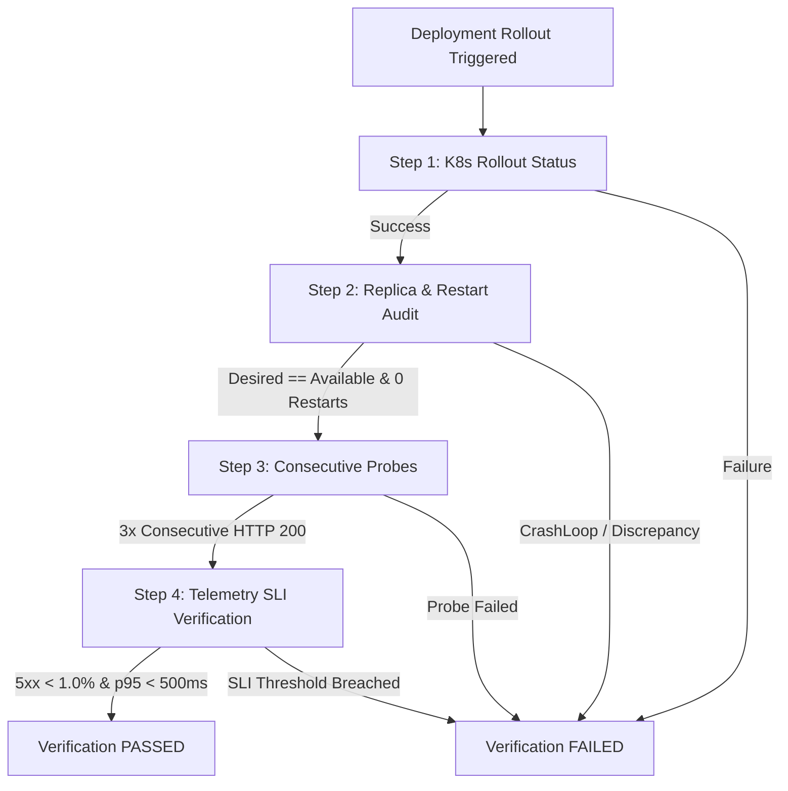

# Deployment Health Verification Engine

**Author**: Senior Site Reliability Engineer, DevOps & Cloud-Native Architect  
**Phase**: Phase 5 — Stage G  
**Status**: IMPLEMENTED & VALIDATED  

---

## 1. Principles & Objectives

In standard continuous deployment pipelines, a deployment is considered "successful" if the Kubernetes deployment controller finishes creating pods and exits `kubectl rollout status` without error.

**From an SRE perspective, this is a dangerous anti-pattern.** A pod can pass container startup while:
- Failing application-level health checks.
- Failing database connection pools.
- Emitting elevated 5xx error rates to live users.
- Experiencing tail latency spikes ($p95 > 500\text{ms}$).

The **ResilienceLab Deployment Health Verification Engine** ([`automation/deployment/verifier.py`](file:///automation/deployment/verifier.py)) enforces independent, multi-step verification before a release can be promoted.

---

## 2. Multi-Step Verification Sequence



---

## 3. Step Specifications

| Step Name | Inspection Target | Acceptance Criteria |
| :--- | :--- | :--- |
| **1. Rollout Status** | `deployment.apps/<service>` | Completes within timeout (120s) |
| **2. Replicas & Restarts** | Pod list & container statuses | Available == Desired, 0 container restarts during window |
| **3. Consecutive Probes** | `GET /health` & `GET /ready` | **3 consecutive successful HTTP 200 responses** |
| **4. Telemetry SLIs** | Prometheus TSDB | HTTP 5xx error rate $< 1.0\%$, p95 latency $< 500\text{ms}$ |

---

## 4. Machine-Readable Audit Output

Every execution generates a structured JSON report in `reports/deployments/verification_<deployment_id>.json`:

```json
{
  "deployment_id": "DEP-20261027160757",
  "service": "api",
  "image_tag": "c49d3e3",
  "passed": true,
  "duration_seconds": 4.74,
  "steps": [
    {"step_name": "k8s_rollout_status", "passed": true},
    {"step_name": "replicas_and_restarts", "passed": true, "details": {"total_pods": 2, "ready_pods": 2}},
    {"step_name": "consecutive_http_probes", "passed": true, "details": {"achieved_streak": 3}},
    {"step_name": "prometheus_telemetry_slis", "passed": true, "details": {"error_rate_pct": 0.0, "p95_latency_ms": 23.35}}
  ]
}
```

---

## 5. Operational Commands

```bash
# Verify active API deployment
python3 automation/deployment/verifier.py --service api --tag c49d3e3

# Or via Makefile
make deployment-verify
```
