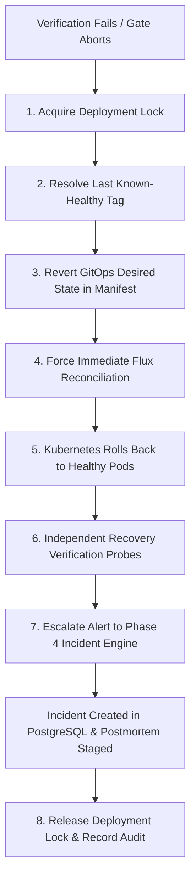

# Automated GitOps Rollback & Incident Escalation Procedure

**Author**: Senior Site Reliability Engineer, DevOps & Cloud-Native Architect  
**Phase**: Phase 5 — Stage J  
**Status**: IMPLEMENTED & VALIDATED  

---

## 1. Principles & Objectives

When a release fails post-deployment health verification or breaches SRE release gates, conventional engineers often run `kubectl rollout undo`. 

**In a GitOps environment, direct `kubectl rollout undo` is an SRE failure pattern:**
- The in-cluster rollback creates immediate configuration drift against Git.
- Within 1–5 minutes, the GitOps controller (Flux CD) detects that cluster state differs from Git and redeploys the broken release, triggering a destructive flapping loop.

The **ResilienceLab Rollback Engine** ([`automation/deployment/rollback.py`](file:///automation/deployment/rollback.py)) executes an automated, GitOps-compatible rollback workflow.

---

## 2. Automated Rollback Workflow



---

## 3. Safety Guardrails & Anti-Flapping

1. **Deployment Lock (`/tmp/resiliencelab_deployment.lock`)**:
   - Ensures mutual exclusion between ongoing promotions and rollbacks.
   - Self-expires after 180 seconds if a process crashes unexpectedly.
2. **Rollback Cooldown**:
   - Prevents cascading multiple rollbacks within a 30-second window.
3. **Phase 4 Incident Creation**:
   - Every rollback automatically emits a `DeploymentHealthVerificationFailed` webhook to the Phase 4 engine.
   - An immutable incident record is stored in PostgreSQL with the failed image SHA, restored image SHA, and failure telemetry.
4. **Independent Post-Rollback Verification**:
   - The rollback is not declared complete until `DeploymentHealthVerifier` validates 3 consecutive successful `/health` and `/ready` probes on the restored version.

---

## 4. Operational Usage

```bash
# Execute automated rollback for failed API release
python3 automation/deployment/rollback.py \
    --service api \
    --deployment-id DEP-2026102701 \
    --failed-tag broken-v2 \
    --reason "Readiness probe failed on port 8000"

# Or via Makefile
make deployment-rollback DEPLOY_ID=DEP-2026102701 FAILED_TAG=broken-v2
```
